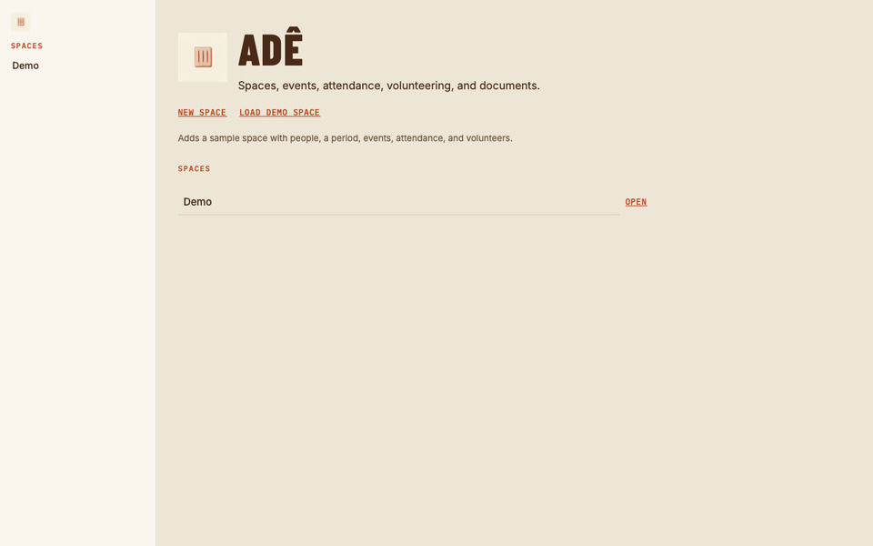
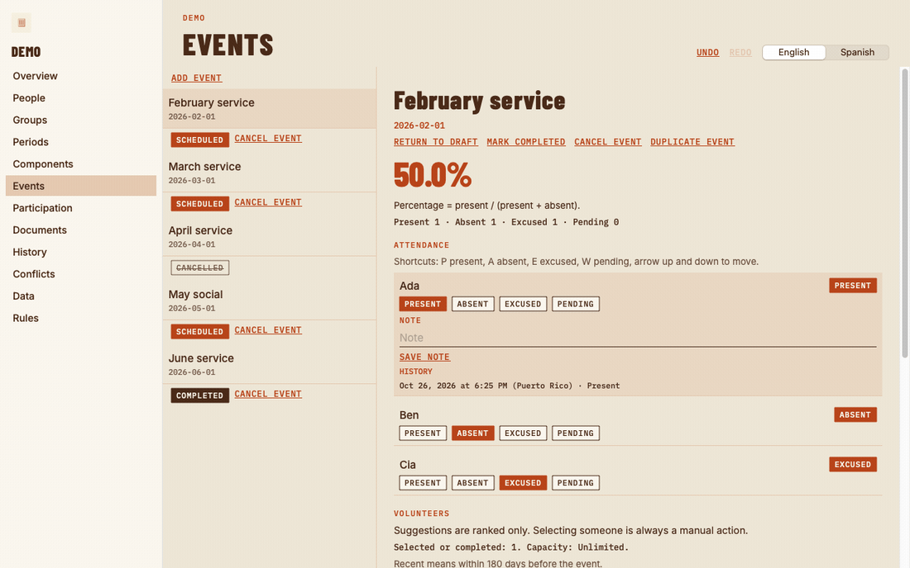
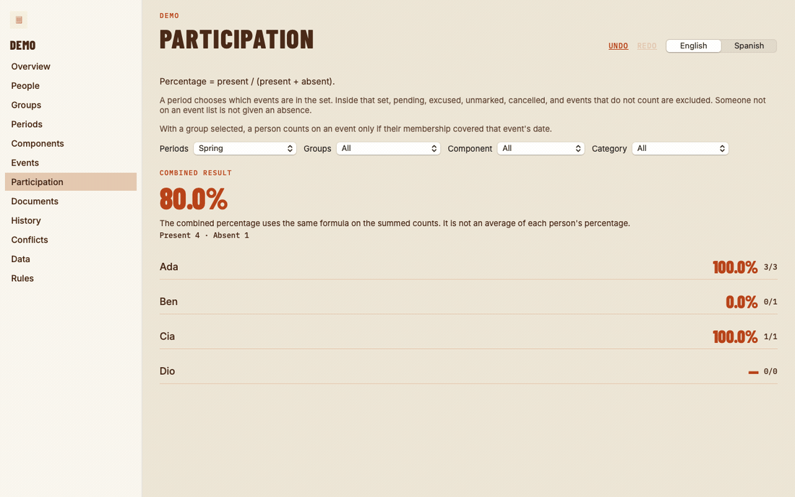
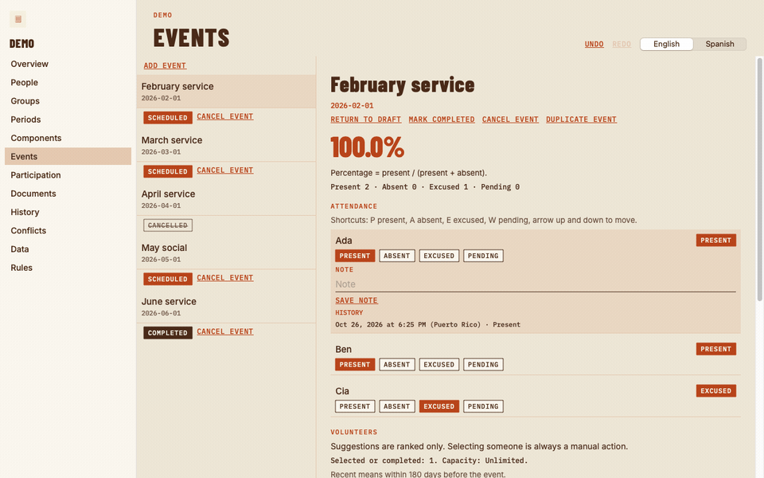

# Adê

Adê is the Mac app for one person who runs a space.

That person keeps the roster, the events, and the record of who was there. The app is not a set of professor, teaching-assistant, and student roles. There is one local operator. Records stay on this Mac. There are no accounts.

Attendance is `present / (present + absent)`. Pending, excused, unmarked, cancelled, events left out of the count, and people who are not on that event's roster stay out of the fraction. A zero denominator is an em dash, not 0%. A combined figure adds the counts. It is not an average of each person's percentage.



The clip is the Mac app the macOS 15 job launches, the Swift package edition, walked after the attendance proof was already fixed. Eight frames, same run: spaces, overview, people, February service, Ben marked present, participation, Spanish, and rules. [The same walk as a video](docs/presentation/walkthrough.mp4).

## February service



February service opens at **50.0%**: present 1, absent 1, excused 1. Cia's excused mark is outside the denominator. Marking Ben present makes it present 2, absent 0. The figure becomes **100.0%**. Excused stays 1. [Same change as a video](docs/presentation/attendance-mark.mp4).

## The space, Spring



Before the mark, Spring is **80.0%**: present 4, absent 1. Ada 3/3, Ben 0/1, Cia 1/1, Dio an em dash (0/0). After Ben is present, the sums are present 5, absent 0, **100.0%**. Ada, Cia, and Dio do not move. Averaging 100, 0, 100, and a blank would not produce 80%, and it would not produce 100% after the mark.

## English and Spanish



The same event, same 100.0%, in Spanish: Porcentaje = presentes / (presentes + ausentes). The package marks with P, A, E, and W. The Xcode app marks with P, A, E, and X.

## What the operator keeps

Spaces. People. Groups, with membership dates. Periods. Components and categories. Events, with a roster, attendance, and volunteers. Participation. Documents. History. Conflicts, when two Macs edited the same space. Data, as JSON export and import. Rules, with the formula on the screen. Settings for language.

Volunteer selection is always manual. The score is not the same in the two editions. The Xcode app uses prior completed volunteering times 3, plus prior attendance times 1. The Swift package, which is the app in the clips, uses the weights in [docs/RULES.md](docs/RULES.md): completed 10, completed within 180 days 5, same component 2, earlier selected 3, earlier interested 1, interested in this event 8, earlier declined −2, earlier volunteer absent −4, earlier present 1 and capped at 10.

## Two editions, two files

This repository builds two native apps. They do not share a data file, and nothing migrates one into the other.

| | Xcode app | Swift package |
| --- | --- | --- |
| Source | `macos/` | `Sources/` |
| Version | 0.4.7 (21) | 1.0.1 |
| Bundle | `com.ade.mac` | a different container |
| Checks | `scripts/test-native.sh` on a Mac | `swift test` |
| Package | `scripts/package-mac.py` | `scripts/package-macos-app.sh` |

[Adê 0.4.7 for macOS](https://github.com/abzu-studio/ade/releases/tag/v0.4.7) is the Xcode app: universal, macOS 14 or later, ad hoc, not notarized. It starts empty. Its attendance formula is the one above. Its paper field, attendance rail, and P/A/E/X keys are that edition, not the frames in this page. Build notes: [docs/BUILD-XCODE.md](docs/BUILD-XCODE.md), [docs/DISTRIBUTION.md](docs/DISTRIBUTION.md), [docs/RULES-XCODE.md](docs/RULES-XCODE.md).

```bash
swift test
bash scripts/package-macos-app.sh
open "dist/Adê.app"
```

The package script writes `dist/Ade-1.0.1-macOS.zip`. Dates in history use Puerto Rico time.

Día clay is the color. The dock icon and the menu glyph (three bars) are part of both apps.

## Repository metadata

The About line on GitHub is not updated from this checkout. `PATCH /repos/abzu-studio/ade` returned HTTP 403: `Resource not accessible by integration` (`gh: Resource not accessible by integration (HTTP 403)`). The description that belongs there:

Mac app for one operator of a space. Attendance is present / (present + absent). Local file. English and Spanish. Not professor, TA, or student roles.

## Fonts

Barlow Condensed (Jeremy Tribby), IBM Plex Mono (IBM), and Inter (Rasmus Andersson), SIL Open Font License 1.1. See `Sources/Ade/Resources/Fonts/OFL.txt`.
