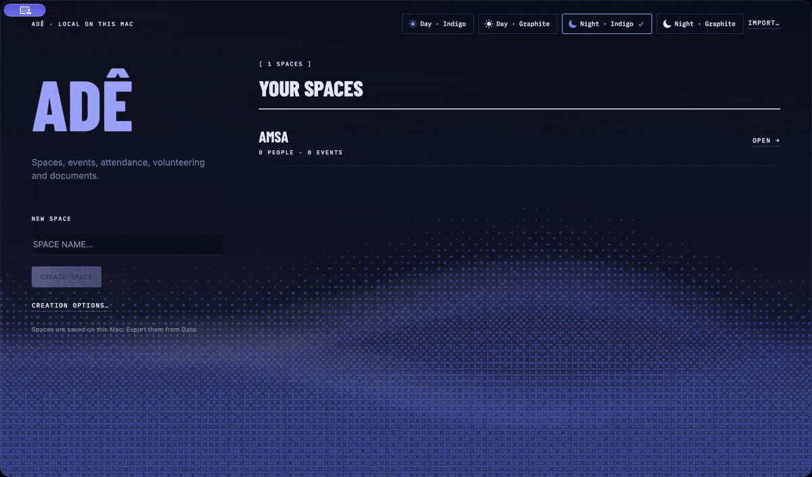
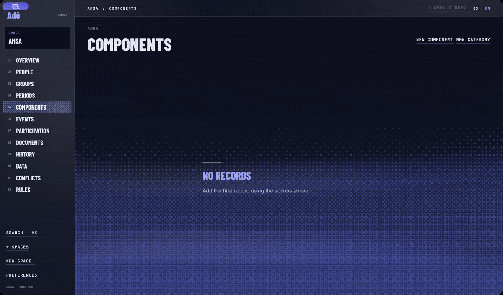
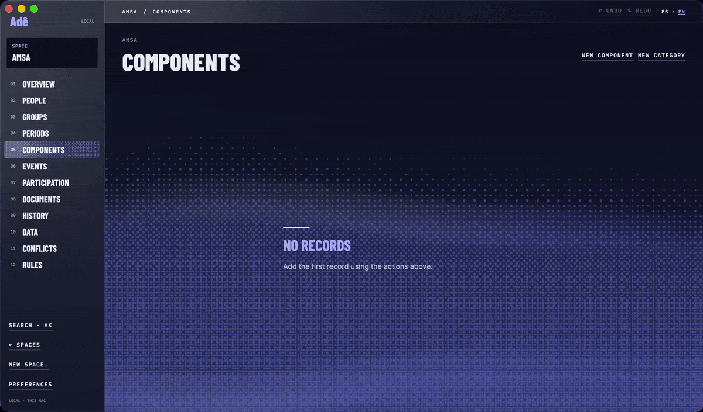
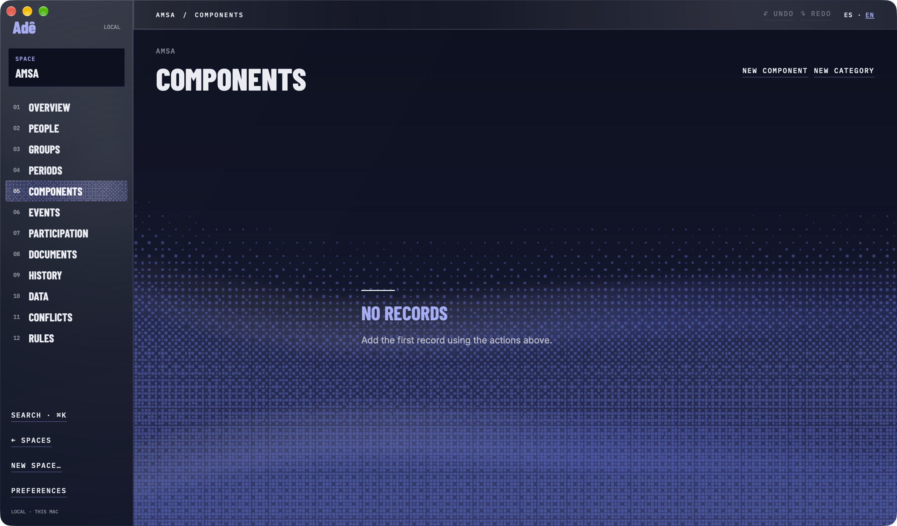

# Adê

Adê is a Mac app for one person keeping a space: people, groups, periods, components, events, attendance, volunteering, and the documents that come out of that record.

The attendance percentage is `present / (present + absent)`. A combined figure adds those counts. It is not an average of each person's percentage. Pending, excused, unmarked, cancelled, events left out of the count, and people who are not on that event's roster are excluded. If the denominator is zero, the app shows an em dash.

Records stay on this Mac. There are no accounts. Another Mac gets a copy by exporting JSON and importing it. If both copies changed the same space, Adê keeps both until someone chooses a version in Conflicts.

The interface is English and Spanish. Día clay is the color. The dock icon and the menu glyph are part of the app.

## Recorded on a Mac

These clips are Adê 0.4.7, the borderless Xcode app, recorded on a Mac. The space is Amsa. Amsa has 0 people and 0 events.



The space hub lists Amsa: 0 people, 0 events. Night · Indigo is selected. The paper field behind the page keeps moving.



Components is empty. The screen says No records.



The same screen goes from English to Spanish and back to English. In Spanish the title is Componentes, and the empty state is Sin registros.



The still is that window. The workspace meets the edge.

## Two editions, two files

This repository builds two native apps. They do not share a data file, and nothing migrates one into the other.

| | Xcode app | Swift package |
| --- | --- | --- |
| Source | `macos/` | `Sources/` |
| Version | 0.4.8 (22) | 1.0.1 |
| Bundle | `com.ade.mac` | a different container |
| Checks | `scripts/test-native.sh` on a Mac | `swift test` |
| Package | `scripts/package-mac.py` | `scripts/package-macos-app.sh` |

Volunteer selection is manual in both. The score is not the same.

The Xcode app scores `completed × 3 + present × 1`: prior completed volunteering times three, plus prior attendance times one. That is the number on the event's volunteer list.

The Swift package uses the weights in `docs/RULES.md`: completed 10, completed within 180 days 5, same component 2, earlier selected 3, earlier interested 1, interested in this event 8, earlier declined −2, earlier volunteer absent −4, earlier present 1 and capped at 10.

## Xcode app

[Adê 0.4.8 for macOS](https://github.com/abzu-studio/ade/releases/tag/v0.4.8) is the universal build (Apple Silicon and Intel), macOS 14 or later. It starts empty. Ad hoc signature, not notarized. macOS may block the first launch; the release notes point at Apple's steps for opening a blocked app. Replacing the app keeps existing Xcode 0.4.x spaces because the bundle id and the file format are unchanged.

Screens: Spaces, Overview, People, Groups, Periods, Components, Events (attendance, volunteers, and the event itself), Participation, Documents, History, Conflicts, Data, Rules, and Settings.

On a scheduled or completed event, click a row or move with the arrow keys, then P, A, E, and X mark present, absent, excused, and pending. N opens the note. Undo is ⌘Z. Search on the attendance list filters the roster. The paper field behind the workspace keeps moving unless Reduce Motion, Reduce Transparency, Increase Contrast, Low Power Mode, an inactive window, or Adê's own motion switch pauses it.

Build and packaging: [docs/BUILD-XCODE.md](docs/BUILD-XCODE.md), [docs/DISTRIBUTION.md](docs/DISTRIBUTION.md). Behavior of this edition: [docs/RULES-XCODE.md](docs/RULES-XCODE.md).

## Swift package

```bash
swift test
bash scripts/package-macos-app.sh
open "dist/Adê.app"
```

`swift test` runs `Tests/AdeCoreTests`. The package script writes `dist/Ade-1.0.1-macOS.zip`. Its rules are `docs/RULES.md`. Its screens calculate the same attendance percentage as the Xcode app and do not invent a second one. Attendance keys match the Xcode app: P, A, E, and X. W still marks pending. Dates in history use Puerto Rico time. Export and import live in Data and the File menu.

## Repository metadata

The About line on GitHub is not updated from this checkout. `PATCH /repos/abzu-studio/ade` returned HTTP 403: `Resource not accessible by integration` (`gh: Resource not accessible by integration (HTTP 403)`). The description that belongs there is the first paragraph of this file: a Mac app for spaces, events, attendance, and volunteering, with attendance `present / (present + absent)`, a local file, and English and Spanish. The Xcode app and the Swift package do not share a data file.

## Fonts

Barlow Condensed (Jeremy Tribby), IBM Plex Mono (IBM), and Inter (Rasmus Andersson), SIL Open Font License 1.1. See `Sources/Ade/Resources/Fonts/OFL.txt`.
